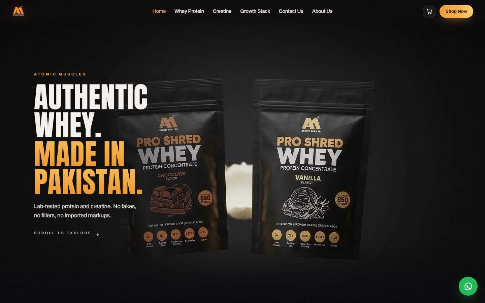
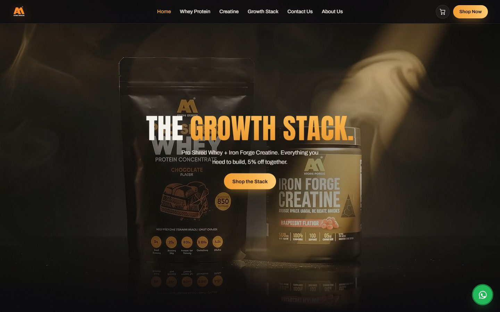
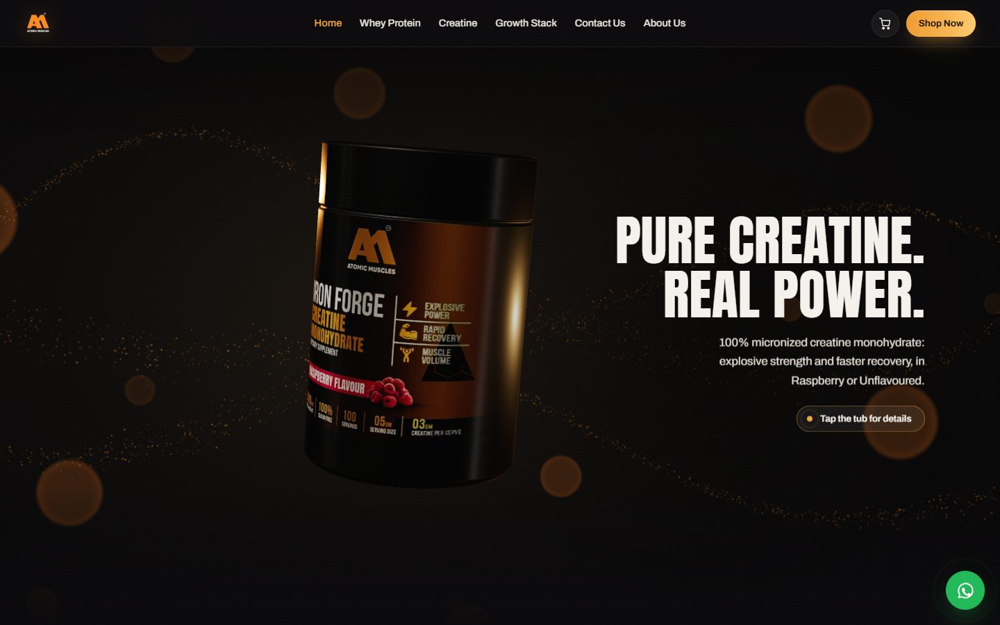
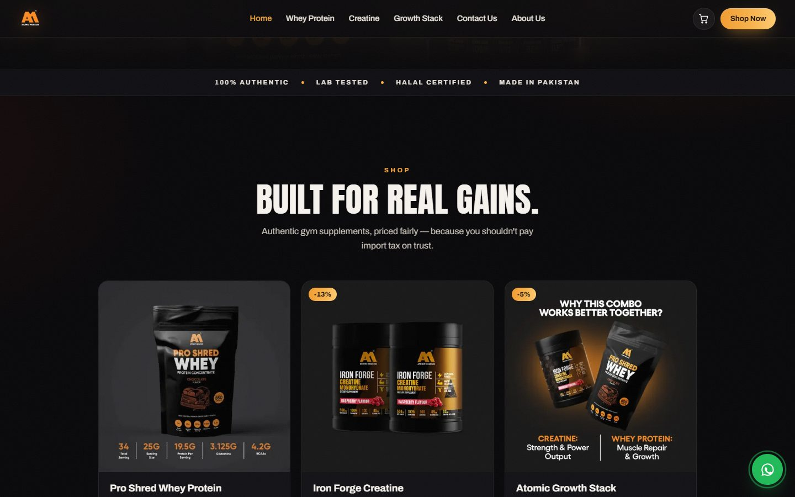
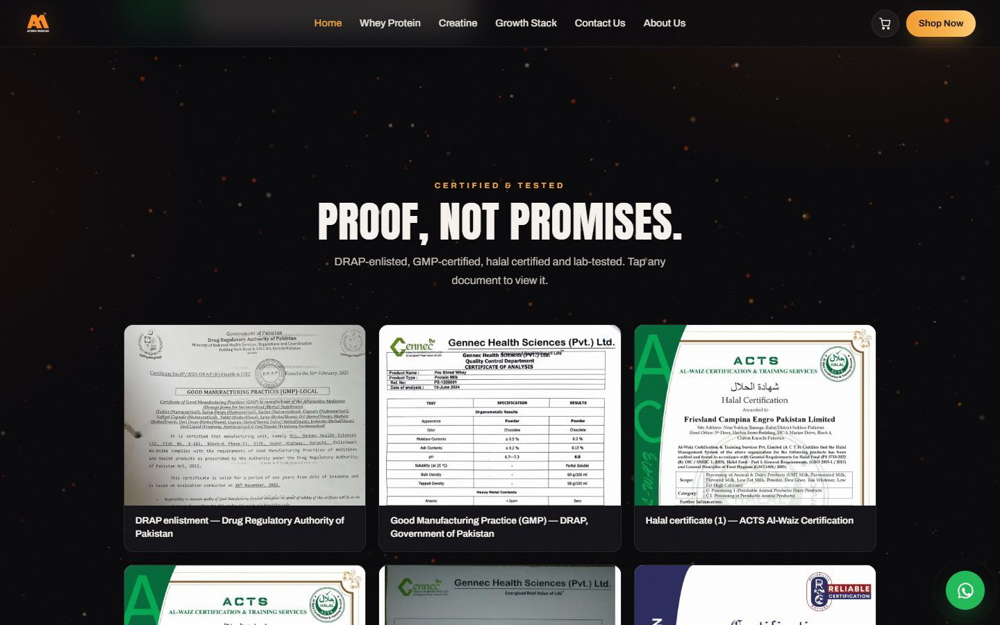
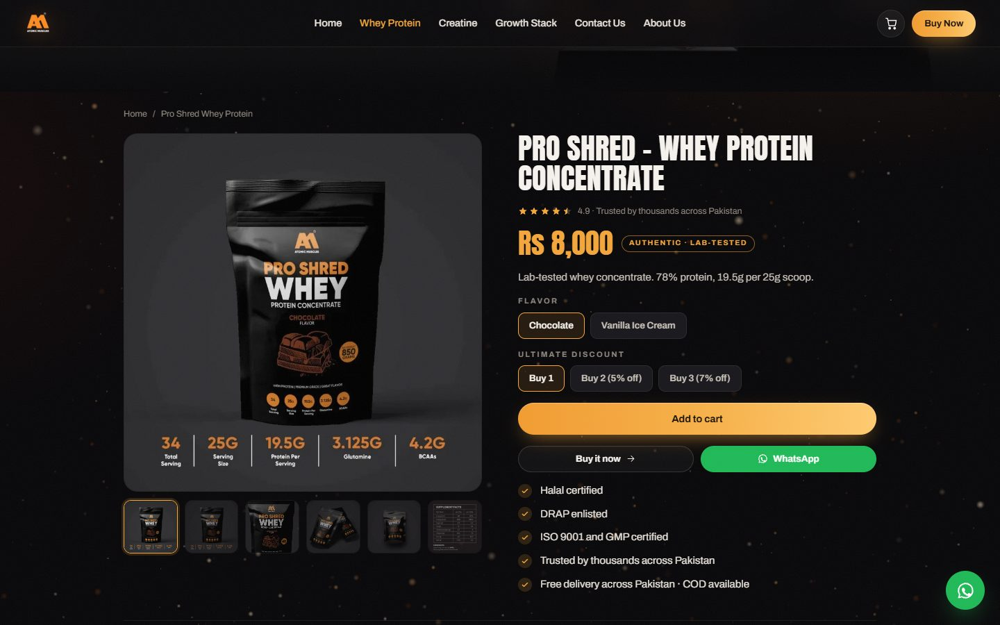
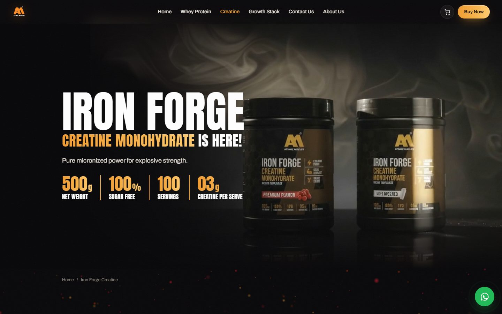
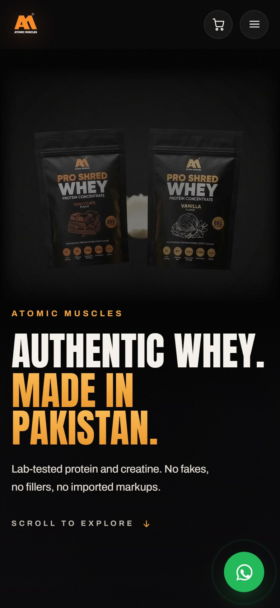
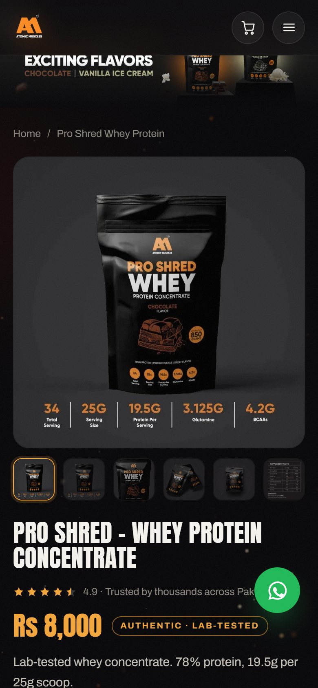
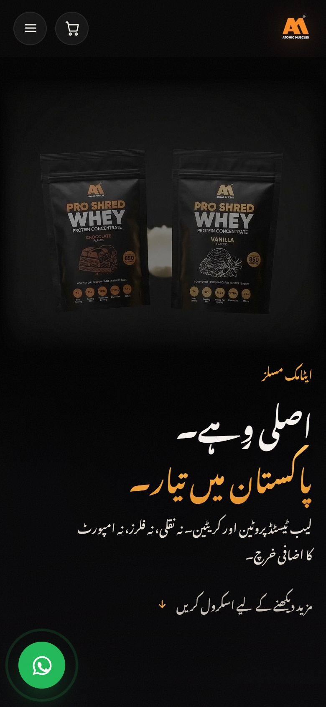

# Atomic Muscles

A single-page storefront for **Atomic Muscles**: authentic whey protein and creatine, made in Pakistan.
It has scroll-driven hero films, a 3D creatine tub built with three.js, a cart that hands off to the
Shopify store or WhatsApp, and full English / اردو (Urdu, right-to-left) support.



## Screenshots

### Desktop

| Scroll-driven hero | 3D creatine tub (drag to turn) |
| --- | --- |
|  |  |
| **Shop** | **Certificates & lab reports** |
|  |  |
| **Product page** | **Product film hero** |
|  |  |

### Mobile

| Home | Product | Urdu (RTL) |
| --- | --- | --- |
|  |  |  |

## Features

- **Home:** three pinned hero scenes. The whey and stack films are scrubbed by scroll position, and the creatine tub is live 3D. Tap the tub for a quick-buy panel.
- **Products:** Pro Shred Whey, Iron Forge Creatine and the Growth Stack, with flavour and discount-tier pickers, galleries, supplement facts, lab reports, reviews and FAQs.
- **Cart:** saved in the browser. Checkout opens a Shopify cart permalink on atomicmuscles.com, or sends the order over WhatsApp.
- **Languages:** English and Urdu, with right-to-left layout and the Noto Nastaliq Urdu font.
- **Routing:** hash routes (`#/whey`, `#/creatine`, `#/stack`, `#/about`, `#/contact`) with animated page transitions.

## Performance

Lighthouse 13 (the engine behind PageSpeed Insights), run against the production build:

| | Performance | Accessibility | Best practices | SEO |
| --- | --- | --- | --- | --- |
| Mobile | 98–99 | 100 | 100 | 100 |
| Desktop | 99–100 | 100 | 100 | 100 |

How it stays fast:

- Images are WebP, with 480 / 720 / 960 / 1440 px widths served through `srcset`.
- The hero image is preloaded at high priority. Everything else loads when it nears the screen.
- three.js, the hero videos and the smooth scrolling load only after the first scroll, touch or mouse move.
- Fonts are self-hosted and preloaded. The Urdu font downloads only in Urdu mode.
- The animation loop sleeps when nothing on screen is moving.

## Getting started

Requires [Node.js](https://nodejs.org/) 18 or newer.

```bash
npm install
npm run dev       # dev server at http://localhost:5177
npm run build     # production build in dist/
npm run preview   # serve the build at http://localhost:5178
```

## Project structure

```
atomicmuscles3jjs.html   the whole site: markup, styles and app code
public/
  img/                   product photos, banners, certificates (WebP + smaller widths)
  tex/                   label textures for the 3D tub
  video/                 hero films, review clips and their poster frames
  fonts/                 Anton, Archivo, Noto Nastaliq Urdu (woff2)
docs/screenshots/        images used in this README
vite.config.js           serves the page at "/", and also builds it as dist/index.html
```

Catalogue data (products, prices, Shopify variant ids) and all English/Urdu copy are near the top of the
`<script type="module">` in `atomicmuscles3jjs.html`.

## Deploying

Upload the contents of `dist/` to any static host (Netlify, Vercel, Cloudflare Pages, GitHub Pages, …).
The build includes `index.html`, so the site works at `/`. For the best PageSpeed score:

- Enable gzip or brotli compression.
- Give `/assets/` long cache headers. Those file names change on every build.

## Handy URL switches

| Parameter | Effect |
| --- | --- |
| `?lang=ur` | open in Urdu |
| `?nointro` | skip the intro curtain |
| `?nogl` | hide the 3D layers |

## Credits

Product photography, videos, certificates and the Atomic Muscles brand belong to Atomic Muscles.
Built with [Vite](https://vitejs.dev/), [three.js](https://threejs.org/) and [Lenis](https://lenis.darkroom.engineering/).
